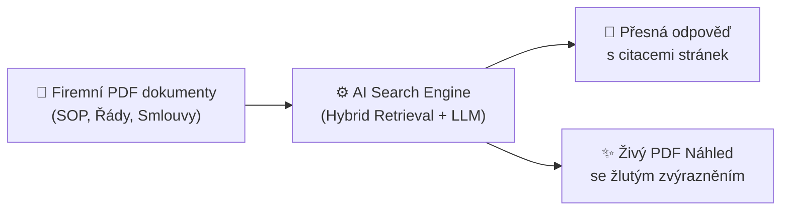
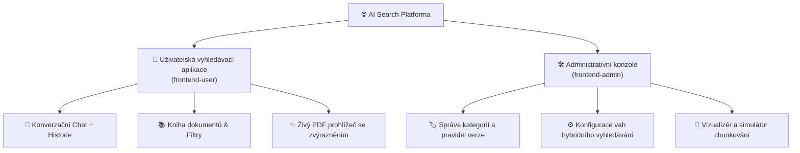
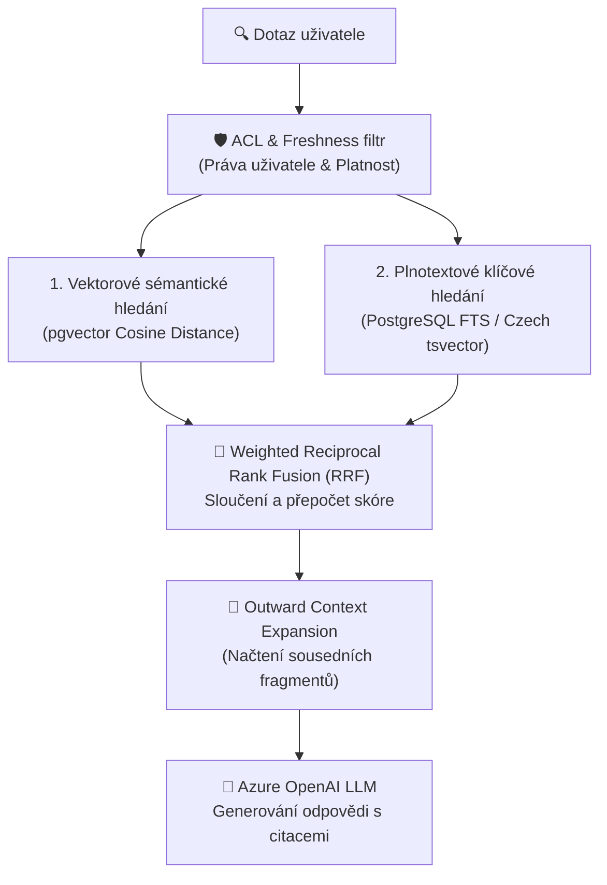

# Marketingové a technické shrnutí projektu AI Search

Vítejte u oficiálního shrnutí platformy **AI Search** – podnikového řešení pro inteligentní vyhledávání a práci s firemními znalostmi. Tento dokument kombinuje marketingovou prezentaci hodnoty pro podnikání, popis designu uživatelského rozhraní a hloubkový technický rozbor architektury.

---

## 1. Marketingové shrnutí & Hodnota pro podnikání (Business Value)

### 🚀 O čem projekt je?
**AI Search** je Enterprise RAG (*Retrieval-Augmented Generation*) platforma navržená pro transformaci statických firemních dokumentů (PDF směrnice, SOP, předpisy, lékařské řády, smlouvy, vysokoškolské řády) v **živou, interaktivní znalostní bázi**. 

Zaměstnanci a administrátoři již nemusejí trávit hodiny manuálním prohledáváním stostránkových PDF dokumentů. Místo toho pokládají dotazy v přirozeném jazyce a během několika sekund získávají přesné, srozumitelné odpovědi.

> [!IMPORTANT]
> **Hlavní konkurenční výhoda:** Garance nulových halucinací díky 100% ověřitelnosti. Každá odpověď obsahuje přesné interaktivní citace s odkazem na číslo stránky a žlutě zvýrazněnou pasáž přímo v originálním PDF souboru.

### 💡 Hlavní přínosy pro organizaci
- **Blesková produktivita:** Zkrácení doby hledání v interních předpisech z desítek minut na jednotky sekund.
- **Nulové riziko halucinací:** Všechna tvrzení generovaná AI jsou striktně ukotvena v ověřených firemních dokumentech (*Grounded Generation*).
- **Víceklientový systém (Multi-tenant) & White-Label:** Jedna platforma dokáže obsloužit různé dceřiné společnosti nebo klienty s plnou izolací dat a vlastním vizuálním brandingem (např. *Dolphin Consulting*, *Nemocnice sv. Alžběty*, *Jihočeská univerzita*).
- **Řízení přístupu a bezpečnost (ACL):** Uživatelé vidí pouze ty dokumenty a odpovědi, k nimž mají oprávnění v rámci svých rolí v Microsoft Entra ID (Azure AD).
- **Automatická správcovská agenda:** Systém sám rozpoznal nahrazené či archivované verze dokumentů, doplňuje kategorie a udržuje znalostní bázi stále aktuální.

---

## 2. UX/UI Design & Uživatelská zkušenost

Aplikace staví na moderním **glassmorphic designu** v rozhraní **Next.js / React / Tailwind CSS**. Zohledňuje odlišné potřeby běžných zaměstnanců a správců znalostní báze, a proto je rozčleněna do dvou specializovaných webových aplikací:

### 👤 1. Uživatelská vyhledávací aplikace (`frontend-user`)
- **Konverzační rozhraní (ChatGPT-style):** Přirozený dialog s AI, podporující vícekolové dotazy a ukládání historie konverzací (*Thread Sidebar*).
- **Odznaky citací (Citation Badges):** V textu odpovědi se zobrazují interaktivní značky (např. `[SOP_2024.pdf, str. 12]`). Kliknutím na odznak se otevře integrovaný náhled.
- **Integrovaný PDF Náhled se žlutým zvýrazněním:** Integrovaný pravý panel zobrazuje přímo vykreslené canvas stránky PDF s přesným žlutým vysvícením citované pasáže (*PyMuPDF Highlighting Engine*). Uživatel nemusí stahovat soubor ani hledat text.
- **Kniha dokumentů (Document Library):** Postranní vyhledatelná knihovna všech dostupných dokumentů s vizuálními štítky platnosti (`PLATNÝ`, `ARCHIV`), kategorií a jazyka (`CZ`, `EN`).

### 🛠️ 2. Administrativní konzole (`frontend-admin`)
- **Správa kategorií a pravidel tagování:** Drag-and-drop rozhraní pro definici pravidel automatické kategorizace, detekce dat účinnosti a nahrazování starších verzí.
- **Ladicí konzole hybridního vyhledávání:** Možnost živě upravovat váhy vektorového vyhledávání a plnotextu, přepínat strategie fúze (*RRF, Vector-Only, Keyword-Only*) a nastavovat okna kontextu (*Siblings, Page, Section*).
- **Živý vizualizér chunkování:** Simulátor dělící dokumenty na fragmenty v reálném čase s barevným odlišením překryvů (*overlaps*) a možností testovat 5 různých algoritmů dělení.

### 🎨 White-Label Theme Engine
Aplikace lze plně vizuálně měnit podle klienta.

---

## 3. Technická architektura a inženýrské detaily

Systém je navržen v souladu s principy **Azure-first enterprise architektury**, s důrazem na zastupitelnost poskytovatelů, modulárnost a vysoký výkon.

### 🛠️ Technologický stoh (Tech Stack)

| Vrstva | Technologie | Popis |
| :--- | :--- | :--- |
| **Backend Framework** | **Python 3.11+ / FastAPI** | Asynchronní vysoce výkonné REST API s Pydantic v2 validací a OpenAPI (Swagger) dokumentací. |
| **Frontend Framework** | **Next.js 14 / React 18 / TypeScript** | Dvě samostatné Single Page / Server-side rendered aplikace s Tailwind CSS a Lucide ikonami. |
| **Databáze & Vyhledávání** | **Azure Database for PostgreSQL (pgvector)** / **Azure SQL Database** | Hybridní vyhledávač kombinující vektorový index (HNSW / Cosine distance) a plnotextový katalog (T-SQL FTS / tsvector). |
| **AI Orchestrace & Modely** | **Azure OpenAI / AI Foundry & LangChain** | Využití modelů `gpt-4o` / `gpt-4o-mini` pro generování a `text-embedding-3-large` pro vektorizaci. |
| **Cloud Hosting** | **Azure Container Apps & Static Web Apps** | Mikroslužbová architektura v Docker kontejnerech s automatickým škálováním. |
| **Úložiště dokumentů** | **Azure Blob Storage** | Izolované klientské kontejnery pro bezpečné ukládání zdrojových PDF a extrahovaných dat. |
| **Infrastruktura jako kód** | **Azure Bicep / PowerShell** | Plně automatizované skripty pro nasazení infrastruktury a CI/CD. |

---

### 🔍 Pokročilý Hybrid Retrieval Engine (Vyhledávání)

Tradiční vektorové vyhledávání selhává u specifických kódů, zkratek a přesných číselných údajů. Tradiční klíčové vyhledávání naopak nerozumí synonymům a kontextu. **AI Search spojuje to nejlepší z obou světů:**

1. **Vektorové sémantické vyhledávání:** Převádí dotaz na více-dimenzionální vektor a hledá konceptuální shodu nezávisle na použitých slovech.
2. **Plnotextové vyhledávání (FTS):** Prohledává dokumenty s českou lematizací a diakritikou pro nalezení přesných shod, čísel směrnic a kódů.
3. **Weighted Reciprocal Rank Fusion (RRF):** Algoritmus sluče výsledky z obou větví, eliminuje duplicity a přiděluje vahové skóre.
4. **Outward Token-Budget Context Expansion:** Pokud je nalezen relevantní fragment, systém automaticky přimíchá sousední fragmenty (*Siblings, Page, Section*), aby LLM model dostal ucelený kontext bez vytržení z věty.

---

### 📄 Dělení dokumentů & Ingestční Pipeline (Chunking)

Kvalita RAG systému přímo závisí na kvalitě dělení dokumentů. Platforma podporuje **5 pokročilých strategií dělení**:

1. **Standardní (Character / Recursive):** Dělení podle odstavců a znakových hranic s definovaným překryvem (*overlap*).
2. **Sémantické (Semantic Splitting):** Detekuje změny v sémantickém významu mezi větami pomocí embeddingových posunů a dělí text v přirozených myšlenkových zlomech.
3. **Strukturované (Structure-Aware Markdown):** Respektuje nadpisy, tabulky a kapitoly dokumentu.
4. **Tokenové (Tiktoken Splitting):** Přesné dělení dle tokenového rozpočtu LLM modelů.
5. **Agentické (LLM-Enriched Chunking):** Využívá AI k vygenerování stručného shrnutí předřazeného k každému fragmentu (*Contextual Retrieval*).

---

### 🛡️ Bezpečnost & Správa prostředí

- **Row level security:** Bezpečnost je dělaná na úrovni databáze. AI model dostane pouze data, ke kterým má uživatel přístup.
- **JWT & Entra ID Autentizace:** Uživatelé se přihlašují přes firemní účty Microsoft 365 / Entra ID. Uživatelské role a skupiny jsou předávány v JWT tokenu a automaticky aplikovány při vyhledávání.
- **Kontejnerizace** Všechny hlavní elementy jsou rozděleny a poskytovány formou samostatně konfigurovatelných API, Azure Blob containerů i backendových Container Apps.

---

## 4. Shrnutí pro rozhodovatele (Executive Summary)

**AI Search** představuje kompletní, produkčně připravené řešení, které překonává běžné prototypy RAG systémů v několika zásadních oblastech:

| Oblast | Běžný RAG Prototyp | **AI Search Platforma** |
| :--- | :--- | :--- |
| **Důvěryhodnost** | Generuje text bez možnosti ověření | **100% citace s živým žlutým zvýrazněním v PDF** |
| **Kvalita vyhledávání** | Pouze jednoduché vektorové hledání | **Hybridní RRF vyhledávání s kontextovým rozšiřováním** |
| **Správa dokumentů** | Manuální nahrávání bez struktury | **Automatické tagování, verze, archivace a detekce platnosti** |
| **Enterprise architektura** | Monolit / Jedna firma | **Multi-tenant, White-label, Azure Cloud Native, Bicep IaC** |
| **Bezpečnost** | Chybí řízení přístupu | **ACL filtry a integrace s Microsoft Entra ID** |

---
*Dokument vystaven pro projekt AI Search (Dolphin Consulting).*
