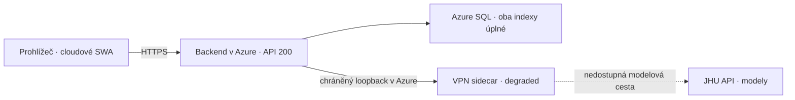

# JHU výpadek a chybějící správa embeddingů — 2. 11. 2026

## Závěr

Cloudová aplikace nebyla připojená k notebooku. Oba veřejné frontendové balíčky používají cloudový backend. Nefungovala JHU modelová cesta: VPN helper vyčerpal limit tří pokusů, přešel do konečného stavu `degraded` a čekal na explicitní restart, pro který chybělo ovládání v administraci. Backend a databáze zůstaly dostupné.

Zároveň byla cloudová příprava embeddingových indexů výslovně zablokovaná aplikační podmínkou. Nešlo o principiální omezení JHU API nebo Azure SQL — Nomic index už v cloudu existoval a byl úplně naplněný. Chyběl připravený provozní postup a UI orchestrace, které by tuto operaci bezpečně zpřístupnily správci.

Tato zpráva popisuje read-only diagnostiku a připravované opravy pracovní verze v0.1.9. Neoznačuje je za nasazené nebo za živě akceptované v Azure.

## Potvrzená měření

Diagnostika proběhla 2. 11. 2026 od 14:56 CET přes veřejné HTTPS soubory a konzoli skutečného cloudového backendu. Do Azure konfigurace, databáze, modelů ani tunelu se při ní nezapisovalo.

| Oblast | Zjištění |
|---|---|
| Admin a uživatelský frontend | Oba HTTP 200; oba obsahují backend `https://ju-ai-search-ca-prod.mangosky-3e5a7049.swedencentral.azurecontainerapps.io`; ve stažených JS souborech nebyl literál `http://localhost:8000`. |
| Backend | `/api/health` HTTP 200, `prod`, runtime `v0.1.7`, přesný tenant `ju-prod`, `DATABASE_BACKEND=azure_sql`. |
| Aktivní revize | `ju-ai-search-ca-prod--preserve-1030-151331`, stav Azure `Running`, jeden backend a vlastní VPN sidecar. |
| Modelová cesta | `JHU_CONNECTION_MODE=sidecar`, `state=degraded`, `code=vpn_upstream_unavailable`. |
| Helper | `attempts=3`, `generation=2`, `tls_channels=2`; agregované příčiny `vpn_tls_failed: 1`, `vpn_upstream_unavailable: 2`. |
| Poslední stav helperu | 30. 10. 2026 **17:27:29 CET**; při odečtu starý přibližně 250 176 s, tedy 69 h 30 min. Jde o poslední zápis konečného stavu, nikoli přesný začátek první síťové poruchy. |
| SQL účty a korpus | 4 účty, 431 dokumentů, 9 372 chunků, 46 konverzací a 72 zpráv. Samotné počty nejsou plným důkazem shody obsahu; nový kompletní hash audit v tomto kroku neproběhl. |
| Původní Azure index | `b1e81c70-686c-481a-bbff-e15f034288ef`, native, 9 372/9 372 aktuálních vektorů. |
| Nomic index | `c536b88c-8df6-4280-8063-ff8d2bb273a9`, native, 9 372/9 372 aktuálních vektorů. |

Uživatel potvrdil, že VPN na notebooku je v době diagnostiky vypnutá. Toto samo neobnovilo vyčerpaný cloudový helper. Použití stejného konkrétního VPN účtu pro notebook i cloud nebylo potvrzeno; nelze jej považovat za prokázanou příčinu.

## Co bylo chybně navržené nebo nedokončené

### 1. Konečný stav VPN bez uživatelsky dostupné obnovy

`scripts/vpn_spike/lifecycle.py` dovoloval tři pokusy za celý život procesu. `scripts/vpn_spike/service.py` po vyčerpání odstranil pracovní VPN credentials/config a zavolal `stop.wait()`. Je to záměrná ochrana proti nekonečnému opakování přihlášení, převzatá z lokálního prototypu. Pro dlouhodobý cloudový provoz ale chybělo doplnění: po stabilním běhu se rozpočet neobnovoval a správce neměl příkaz k novému bootstrapu tunelu přes UI.

Liveness sidecaru pouze ověřuje život procesu na TCP 18082. Čekající proces tento test splňuje, proto Azure nemá důvod ho samo restartovat. Zdraví backendu je správně nezávislé na JHU, aby zůstaly dostupné účty, dokumenty, historie a Azure modely. UI ale tento rozdíl dostatečně nevysvětlovalo.

### 2. Obnova snapshotu není restart VPN

`POST /api/models/connection/refresh` znovu načítá backendový snapshot připojení a API credentials. Neobnovuje vyčerpaný retry budget helperu ani nespouští nový OpenVPN proces. Kliknutí na načtení modelového inventáře navíc jen opakuje discovery; síťovou závadu neřeší. Tyto akce nesmějí být vydávané za opravu zaseknutého tunelu.

### 3. Zavádějící text o FastAPI a portu 8000

`frontend-admin/app/translations.ts` připojoval ke každé chybě dotazu text „Ujistěte se, že Váš FastAPI server běží na portu 8000“. Tento univerzální vývojářský text se zobrazil i u legitimní serverové chyby JHU spojení. Neznamenal, že prohlížeč posílá dotazy na uživatelův počítač. Veřejné JS soubory potvrzují opačnou skutečnost.

### 4. API online bylo zaměnitelné s dostupností vybraného modelu

Zelený indikátor měřil pouze backend health. Odpověď HTTP 200 z backendu je slučitelná s nedostupnou VPN/modelovou službou. Bez druhého indikátoru to působilo jako nekonzistentní stav celé aplikace. Požadavek se správně automaticky nepřepnul na jiný model, ale příčina nebyla v UI dostatečně viditelná.

### 5. Cloudová správa indexů byla skutečně zablokovaná

`app/ingestion/admin_indexes.py` povoloval `/prepare` jen při `APP_ENV=local`, loopback SQL Serveru a databázi `ai_search_local`. V Azure vracel `can_prepare=false`; frontend proto ovládání nevykreslil. Původní implementace navíc prováděla celý výpočet uvnitř dlouhého HTTP požadavku a měla pouze procesový semafor. Samotné odstranění podmínky by neřešilo gateway timeouty, přerušení nasazení, více procesů ani průběh úlohy.

Předchozí ruční příkazy vytvářely a plnily nativní indexy úspěšně. Infrastruktura tedy fungovala, ale správa přes UI nebyla dotažená pro cloud. Toto omezení mělo být v produktu i při předání zřetelněji popsané.

### 6. Verze zdrojů nebyla verzí běžícího cloudu

Vydání v0.1.8 z 30. 10. bylo publikací na GitHub/Forgejo, nikoli nasazením Azure. Proto cloud i snímek obrazovky správně vykazují v0.1.7. Není to důkaz, že se nepodařilo publikovat Git. Nynější opravy budou provozně účinné až po samostatném rollout kroku.

## Co není prokázané

Bez podrobnějších logů na JHU VPN/API straně nelze rozlišit původní výpadek sítě, odpojení na VPN serveru, souběh účtu, chybu forwarderu nebo nedostupnost JHU API. Agregovaný `vpn_tls_failed` a `vpn_upstream_unavailable` nejsou důkazem konkrétní varianty. Z tohoto měření neplyne potřeba dalšího navýšení SQL ani CPU/RAM.

Původní data nebyla diagnostikou smazaná a oba indexy mají úplné pokrytí. Nedokládá to kvalitu odpovědí: dřívější případ R_583/Nomic zůstává samostatně otevřený. [Dřívější plný test zachování dat](../deployments/2026-10-30-preservation-test.md) není náhradou za nové měření relevance nebo za nové nasazení.

## Připravená náprava

- SQL tabulka poslední správní úlohy na přesný tenant, heartbeat a podmíněné převzetí; starý pracovník nemůže přepsat novou úlohu. HTTP 202, samostatný worker a průběh po dávkách řeší dlouhý přepočet bez dlouhého frontendového požadavku.
- Vytvoření indexu přímo z ověřeného API modelu; dopočítání, obnovení a zastavení v menu Chunkování. Nativní vektory a neměnné profily; bez změny původních textů a bez aktivace nebo mazání původního indexu.
- Cloudové zapnutí je explicitní a vyžaduje jednu aditivní migraci. Není zapnuté pouhým startupem aplikace.
- Oddělený indikátor dostupnosti JHU v obou konzolích. Správce má explicitní **Znovupřipojit JHU** pro vyčerpaný helper. Akce používá chráněné loopback řízení, odmítne aktivní modelové požadavky, ukončí starou relaci a před novým tunelovým pokusem znovu načte schválené Key Vault reference. Nevytváří druhý cloudový VPN kontejner.
- Po pěti minutách souvisle ověřeného zdraví se obnoví rozpočet následujících přechodných chyb. Při chybě autentizace/certifikátu se nadále neprovádí nekonečné automatické přihlašování. Zcela vyčerpaný helper vyžaduje vědomou akci správce.
- Odstraněn zavádějící obecný text o lokálním portu 8000. Modely se automaticky nezaměňují a přerušené generace se neopakují.

Podrobný návod: [cloudová správa embeddingových indexů](../development/cloud-embedding-management.md). Konečné výsledky ověření a stav nasazení jsou doplněné níže po dokončení kontrol.

## Konečné ověření připravené v0.1.9

| Kontrola | Výsledek |
|---|---|
| Celý hlavní backend, skutečný wheel a lokální SQL Server | **752 passed / 23 expected skips**. |
| Celý čistý JHU-only kandidát, bez soukromých env | **559 passed / 151 expected skips**, včetně wheelu. Lokální SQL/native/live testy, které bez konkrétního prostředí neběží, nejsou vydávané za úspěšné. |
| Cílené úlohy/preservation na SQLite i skutečném SQL Serveru | **65 passed**. |
| Regrese frontendových odpovědí, relací a konkrétního embeddingového profilu | **9 passed**. |
| Produkční JHU admin a uživatelský build | Oba sestavené, TypeScript prošel. Nejde o nové živé GUI ověření v Azure. |
| Docker backend/helper | Oba lokálně sestavené; import a verze backendu ověřeny bez sítě, všechny aplikační zdroje image odpovídají pracovnímu stromu. |
| Linuxový gateway/supervisor | Dva celé explicitní reconnect/bootstrap/cleanup cykly přes skutečný HTTP gateway, s vypnutou sítí, syntetickým bootstrapem a falešným VPN child procesem. Oba HTTP 202, nula skutečných VPN procesů, soukromé soubory odstraněné. Není to živý VPN/JHU test. |
| Bezpečný neúspěšný bootstrap image | UID 65532, síť `none`, žádné host porty nebo volume, pevný bezpečný chybový kód, žádné soukromé bootstrap soubory. Pouze vlastní krátký testovací kontejner byl následně odstraněn. |
| Dokumentace, balíček a privátní hodnoty | 495 veřejných zdrojů, 367 JHU souborů včetně 107 dokumentů, bez ADR. Syntaxe/odkazy/navigace/verze prošly; 13 známých privátních hodnot bez shody. Runtime kandidáta se shoduje s testovanými zdroji. |

Během vývoje selhal nový test simulace při opakované práci se souborem stavu. Stavový zápis je nyní v této jednotkové simulaci oddělený od lifecycle; soukromé pracovní soubory se dál ověřují skutečně. Potom proběhly znovu celé hlavní i JHU sady s výše uvedenými zelenými výsledky. Samostatný skutečný Linuxový test ověřil oba cykly se skutečným stavovým souborem/gateway bez sítě. Nezůstal otevřený tento testovací problém.

## Stav cloudu po přípravě a nutné nasazení

Opakované read-only ověření **2. 11. 2026 v 17:34 CET** potvrdilo stejnou revizi `preserve-1030-151331`, runtime **v0.1.7** a stále `degraded / vpn_upstream_unavailable / attempts=3`. SQL je **S2 / 50 DTU / Online**, bez změny kapacity v tomto úkolu. Existující SQL identita má `CREATE TABLE` i `ALTER` nad schématem `dbo`; není tedy zjištěna potřeba nových rolí pro navrhovanou tabulku/index. Tři pokusy jsou aplikační retry budget VPN, nikoli vyčerpaná Azure SQL kvóta.

**Opravy v0.1.9 zatím nejsou nasazené.** Do Azure, ACR ani Forgejo/GitHub se v tomto kroku nic nenahrávalo; SQL tabulka ani nový produkční index se nevytvářely. Notebooková VPN se nezapínala a žádný lokální helper s živou JHU VPN relací se nespouštěl. Pro testy zůstal běžet uživatelem spuštěný lokální SQL kontejner.

Lokálně připravené obrazy (nikoli tvrzení o už nahraném ACR):

- Backend `ai-search-backend:v0.1.9-prepared`: `sha256:a5e542dfa2a303171180516b348ced611b5e462d4933ceb26ae55c8fb205e827`.
- Helper `ai-search-jhu-helper:v0.1.9-prepared`: `sha256:9ed7ab1f20ceaa4bd746e6fd64079f4bc3eda8752dbe44742e57922786c6e689`.

Dalším konkrétním krokem je schválené nasazení těchto oprav do existujících JHU resources, jediná aditivní migrace tabulky úloh a následná native/UI akceptace. Kapacity, účty, dokumenty, prompty, historii a oba původní indexy je nutné zachovat. Nový plný přepočet korpusu, aktivace defaultu nebo vyřešení relevance R_583 nejsou skrytou součástí deploymentu.

## Navazující schválené vydání s přehledem souborů

Výše uvedený stav přípravy a cloudové nedostupnosti je časový snímek před dalším souhlasem uživatele. Následně uživatel výslovně schválil GitHub, Forgejo a backend/frontend a požádal o průběhové okno. Finální zdroje navíc obsahují seznam zpracovaných souborů, aktuální dávku/fázi, hledání, zavření/znovuotevření a přehled chyb. Hlavní sada 755/23 očekávaných přeskočení a čistý JHU kandidát 561/152 prošly. Finální backend image má lokální ID sha256:379d17d8a3b90925c3b6b36d569600d7143cb256adccc31d467aa08c1eaba961; helper zůstává výše uvedený připravený obraz. Notebooková VPN byla zapnuta na výslovnou žádost pro publikaci do Forgejo; lokální JHU helper se nespouští. Dokončení jednotlivých zdrojových publikací a skutečný runtime rollout je nutné ověřit samostatně podle vzdálených refs a aktivní revize/API, nikoli zpětně dovozovat z původního diagnostického snímku.
